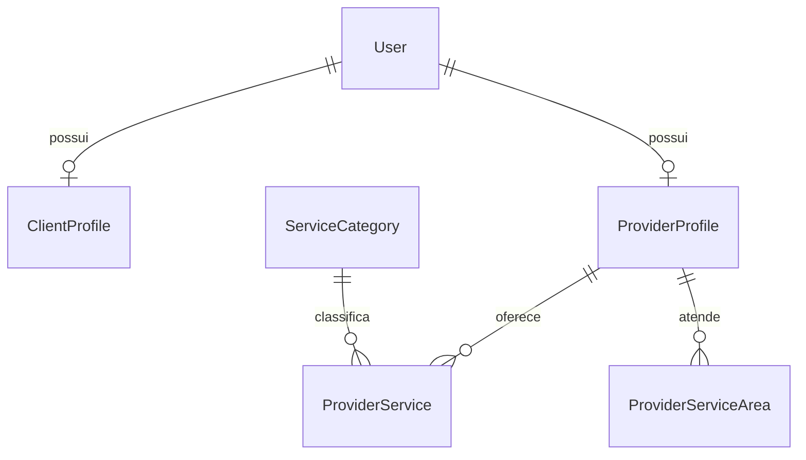

# Fase 2.1 — Fundação de persistência SQL Server

Branch `feature/fase-2-1-sqlserver-prisma`, baseada na correção SDK 58 (`3e4f1ba`). A Fase 1 permanece demonstrativa; não há autenticação, endpoints CRUD de negócio, pagamentos, avaliações, solicitações ou contratações. A validação física anterior da Fase 1 foi informada pelo usuário; não foi repetida neste ambiente.

## Modelo



| Entidade            | Campos e restrições principais                                                 |
| ------------------- | ------------------------------------------------------------------------------ |
| User                | email obrigatório único, nome, telefone opcional; sem senha nesta etapa        |
| ClientProfile       | userId único, cidade padrão Araranguá e UF SC                                  |
| ProviderProfile     | userId único, nome profissional, biografia opcional                            |
| ServiceCategory     | slug único, nome, ordem de exibição                                            |
| ProviderService     | prestador + categoria + título únicos, descrição opcional                      |
| ProviderServiceArea | prestador + UF + cidade + bairro únicos; bairro vazio significa cidade inteira |

Todas têm UUID `uniqueidentifier`, `isActive`, `createdAt` e `updatedAt`. IDs usam `newid()` no SQL Server. Defaults de datas usam `sysutcdatetime()` (UTC); `updatedAt` é atualizado automaticamente pelo **Prisma**, não por trigger para SQL manual. Campos textuais usam tipos de tamanho limitado e Unicode quando necessário.

Um usuário pode ter simultaneamente os dois perfis, sem duplicar conta. As relações têm FKs e `ON DELETE/UPDATE NO ACTION`: sem cascatas nem múltiplos caminhos de cascata do SQL Server. Desativação usa `isActive`; a futura camada de negócio deverá verificar também o estado das entidades relacionadas. Não foram criados modelos antecipados para pedidos.

Índices atendem listagem ativa/cronológica, categorias por ordem, busca por categoria/prestador e atendimento por cidade/UF. As constraints únicas também indexam email, slug e os relacionamentos 1:1. Chaves foram conferidas abaixo de 900 bytes. Unicidade textual segue a collation existente de OminiDB; normalização de email/cidade e validação de campos de entrada pertencem à futura API de negócio. Não presuma comparação de email independente de maiúsculas sem conferir a collation. Não há API de gravação de usuários nesta fase.

## Prisma e geração

Prisma CLI, Client, adaptador MSSQL e ferramentas internas estão fixados em **6.19.3**. O runtime usa o adaptador oficial `@prisma/adapter-mssql`/driver `mssql` com `engineType="client"`, sem engine Rust. SQL Server é o único datasource. A combinação usa TDS e tipos suportados; a execução real em SQL Server 2025 Developer ainda deve ser validada localmente.

`npm ci` gera o cliente via postinstall do workspace. Para repetir:

```powershell
npm run prisma:generate
npm run prisma:validate -w @omini/api
npm run check:migrations -w @omini/api
```

A validação usa WASM do próprio Prisma; a geração usa o gerador JS oficial via `@prisma/internals` **fixado na mesma versão**, com registro explícito. O gerador confirma `requiresEngines: []`. Não há download de engines nativas, desativação de TLS ou checksum. Os pacotes continuam protegidos pela integridade do npm/lockfile. Essa integração interna é sensível à versão: atualize as quatro dependências juntas e execute os testes ao evoluir Prisma. O destino explícito `node_modules/.prisma/client` na raiz evita gerar um cliente em uma pasta errada no monorepo. Nada gerado é versionado.

A CLI convencional continua disponível como `npm run prisma:generate:cli -w @omini/api`. Nesta nuvem seu bootstrap de schema-engine retorna 403 em `binaries.prisma.sh`; a tentativa de adicionar o domínio ao draft retornou `draft_not_editable`, portanto nenhuma liberação foi confirmada. Isso não afeta a geração/validação WASM ou o runtime JS. A CLI de **migrations** ainda necessita dos artefatos verificados, que devem ser obtidos normalmente no Windows. Nunca use `PRISMA_ENGINES_CHECKSUM_IGNORE_MISSING` ou desative TLS para contornar a falha.

## Configuração local Windows

Pré-requisito informado pelo usuário: SQL Server 2025 Developer, instância OMINI, TCP habilitado em `127.0.0.1:1433`, banco existente **OminiDB**, login **omini_app**. Não é necessário recriar servidor ou banco. A porta fixa identifica a instância; não inclua `\OMINI` junto ao host no URL TCP.

Na raiz do clone, preserve alterações locais e `.env` existentes:

```powershell
git status --short
git fetch origin
git switch feature/fase-2-1-sqlserver-prisma
git pull --ff-only
npm ci
if (!(Test-Path apps/api/.env)) { Copy-Item apps/api/.env.example apps/api/.env }
if (!(Test-Path apps/api/.env.migrations)) { Copy-Item apps/api/.env.migrations.example apps/api/.env.migrations }
```

Edite os arquivos **somente localmente**; não envie senhas no chat, logs ou Git. `apps/api/.env` contém `DATABASE_URL` com omini_app. `apps/api/.env.migrations` contém apenas `MIGRATION_DATABASE_URL` com omini_migrator. Esse segundo arquivo só é lido pelo comando de migração; não é carregado pela API.

Formato runtime (placeholder, não é senha real):

```dotenv
DATABASE_URL='sqlserver://127.0.0.1:1433;database=OminiDB;user=omini_app;password={REPLACE_LOCALLY};encrypt=true;trustServerCertificate=true'
```

Formato migration: igual, com variável `MIGRATION_DATABASE_URL` e usuário `omini_migrator`. O wrapper não usa `DATABASE_URL` como fallback, rejeita omini_app, exige OminiDB e só permite `status` e `deploy`.

### Caracteres especiais e TLS

O URL é no estilo JDBC do Prisma, não um URL HTTP. Envolva valores com delimitadores (por exemplo `;`, `=` ou espaços) entre `{...}`. Um `}` literal dentro do valor é representado por `}}`. Exemplo **fictício**: valor `exemplo;a=b}c` → `password={exemplo;a=b}}c}`. Não aplique percent-encoding ao URL inteiro nem inclua chaves como parte da senha.

O parser local converte a string em configuração estruturada do driver para preservar o conteúdo: o atalho de string do adaptador 6.19.3 não interpreta corretamente valores entre chaves com ponto e vírgula. Há testes de delimitadores, chaves, parâmetros duplicados e erros sem valores sensíveis.

Também respeite a sintaxe de aspas do dotenv: o exemplo usa aspas simples externas para preservar barras e `#`; se o próprio valor contiver aspas simples, escolha a citação externa apropriada conforme dotenv ou injete a variável de forma segura pelo sistema, sem expô-la no terminal. Não copie a senha para comandos literais no histórico.

`encrypt=true` é mantido e `encrypt=false` é rejeitado pelo parser. `trustServerCertificate=true` só é adequado ao desenvolvimento local com certificado autoassinado; em implantação use certificado confiável e `trustServerCertificate=false`. O parser usa 5 s como timeout de conexão/requisição por padrão. `connectionTimeout`, quando necessário no runtime JS, é expresso em milissegundos e limitado a 120 s; não o acrescente ao URL da CLI de migrations, que usa suas próprias opções de timeout. Não configure credenciais em `EXPO_PUBLIC_*`.

## Permissões: duas identidades

1. No SSMS, com uma sessão administrativa confiável, crie um **novo login SQL** chamado `omini_migrator` usando a UI e senha privada local. Não acrescente funções de servidor; mantenha somente public. Não use `sa` na aplicação.
2. Selecione **OminiDB** e revise/execute `docs/sql/migration-permissions.sql`. Ele cria usuário e role idempotentemente, sem senhas. A role permite CREATE TABLE, VIEW DEFINITION, ALTER/REFERENCES e DML no schema dbo apenas dentro de OminiDB, incluindo a tabela de histórico Prisma. Não concede CREATE DATABASE, ALTER LOGIN ou privilégios de servidor.
3. Essa role **pode alterar objetos de dbo em OminiDB**, não apenas as seis tabelas. Use-a exclusivamente em migrations revisadas, proteja seu arquivo e desabilite o login quando fora de uso se adequado ao fluxo operacional. Não conceda db_owner/sysadmin.
4. Depois de aplicar a migration, revise/execute `docs/sql/runtime-permissions.sql`. A role runtime concede apenas SELECT/INSERT/UPDATE nas seis tabelas, sem DELETE, DDL ou acesso à tabela `_prisma_migrations`. O seed usa omini_app.
5. Os scripts adicionam permissões; **não removem** concessões antigas. Confira o login omini_app: não deve ser sysadmin, db_owner ou db_ddladmin nem ter CREATE TABLE/ALTER. Permissões herdadas devem ser corrigidas pelo DBA, sem revogações automáticas neste projeto.

Conectado como omini_app no SSMS, confira:

```sql
SELECT DB_NAME() AS databaseName,
       IS_SRVROLEMEMBER('sysadmin') AS isSysadmin,
       IS_MEMBER('db_owner') AS isDbOwner,
       HAS_PERMS_BY_NAME(DB_NAME(), 'DATABASE', 'CREATE TABLE') AS canCreateTable;
```

Esperado: OminiDB e zeros para os privilégios acima. Depois confira operações permitidas nas tabelas em uma transação de teste local, sem dados reais de usuários.

## Revisar e aplicar migrations — somente no Windows

Migration versionada: `apps/api/prisma/migrations/20261109000000_persistence_foundation/migration.sql`. É SQL inicial aditivo derivado do DMMF Prisma, com seis CREATE TABLE, cinco FKs, seis constraints únicas e cinco índices secundários. Validação estática compara colunas, tipos, nulabilidade, defaults, índices e ações referenciais com o schema. Ela **não é um teste de execução T-SQL** nem um `migrate diff` contra banco real.

O script não cria/apaga bancos nem remove dados. Recusa banco diferente de OminiDB e qualquer colisão com as seis tabelas existentes, antes dos CREATEs. Usa transação e XACT_ABORT. O Prisma registra o histórico separadamente. **Não execute o SQL manualmente no SSMS e depois o deploy**: use o comando de migration para manter histórico e checksum consistentes.

Antes de aplicar, faça backup local e inspecione no SSMS (leitura):

```sql
SELECT DB_NAME() AS databaseName;
SELECT s.name AS schemaName, t.name AS tableName
FROM sys.tables t JOIN sys.schemas s ON s.schema_id = t.schema_id ORDER BY s.name, t.name;
IF OBJECT_ID(N'dbo._prisma_migrations', N'U') IS NOT NULL
    SELECT migration_name, finished_at, rolled_back_at FROM dbo._prisma_migrations ORDER BY started_at;
```

Se houver tabelas alvo ou histórico inesperado, **pare e reconcilie o histórico/baseline em tarefa específica**. Não use reset, db push, limpeza do banco ou `migrate resolve` para esconder conflito.

Após revisar inventário, SQL e credencial de migration, execute na raiz:

```powershell
npm run prisma:validate -w @omini/api
npm run check:migrations -w @omini/api
npm run db:migrate:status -w @omini/api
# Uma migration pendente pode resultar em código de saída não zero no status inicial.
# Aplique somente após a revisão do SQL e do inventário:
npm run db:migrate:deploy -w @omini/api
if ($LASTEXITCODE -ne 0) { throw 'Deploy nao concluido; revise localmente antes de continuar.' }
npm run db:migrate:status -w @omini/api
```

O wrapper usa a credencial separada, propaga o exit status e suprime mensagens do driver que podem conter detalhes internos. Uma saída não zero pode significar migrations pendentes, falha de rede/engine, permissões ou conflito de histórico; verifique esses itens localmente. Não há comando automático de reset/reparo. Nenhum desses comandos de conexão/deploy foi executado pela nuvem.

Conceda então as permissões runtime e teste o seed:

```powershell
npm run db:check -w @omini/api
npm run db:seed -w @omini/api
if ($LASTEXITCODE -ne 0) { throw 'Seed nao concluido.' }
npm run db:seed -w @omini/api
```

O seed usa transação e upsert por slug para as oito categorias. Não cria usuários/prestadores, não apaga categorias e não modifica registros já existentes (inclusive nome editado e desativação). Execute uma instância de seed por vez. Confira no SSMS os oito slugs esperados e a ausência de duplicados; categorias pré-existentes adicionais são preservadas.

## API e diagnóstico

Default em `.env.example`:

```dotenv
NODE_ENV=development
PERSISTENCE_ENABLED=false
DB_DIAGNOSTICS_ENABLED=false
```

Com false, não é instanciado cliente de conexão nem feito ping. O app demonstrativo e `/api/health` continuam funcionando antes de aplicar migrations. A API nunca aplica migrations ou seeds ao iniciar.

Depois da revisão/aplicação local, habilite `PERSISTENCE_ENABLED=true`. `DATABASE_URL` passa a ser obrigatória. O módulo injeta PrismaService, prepara o cliente no início e desconecta no encerramento. Uma falha de conexão não derruba o processo; warnings e respostas são genéricos. O diagnóstico pode reavaliar a conexão caso o banco se recupere.

Habilite `DB_DIAGNOSTICS_ENABLED=true` apenas durante diagnóstico local:

```powershell
npm run dev:api
# Em outro terminal na raiz:
Invoke-RestMethod http://localhost:3000/api/health
Invoke-RestMethod http://localhost:3000/api/development/database
```

O diagnóstico responde 200 com status `ok` ou `disabled` e timestamp; indisponibilidade gera 503 genérico. Só atende em NODE_ENV=development, flag habilitada e endereço loopback; fora disso retorna 404. Está excluído do Swagger público. Não habilite trust proxy para contornar o filtro; não exponha esse endpoint por proxy/túnel. `/api/health` continua sendo vida do processo, **não** disponibilidade do banco. O ping é apenas SELECT 1: não prova que tabelas/migrations estão prontas.

Para o mobile, mantenha `EXPO_PUBLIC_API_URL` com o IP do Windows na LAN e `/api`, sem localhost. O app continua consultando apenas o health existente e usando os dados demonstrativos. Nenhum arquivo do mobile foi alterado nesta fase.

## Evidências e pendências

Resultado da rodada final após instalação limpa:

| Verificação                                      | Resultado                                                          |
| ------------------------------------------------ | ------------------------------------------------------------------ |
| `npm ci`                                         | Passou; postinstall gerou o cliente de seis modelos                |
| Prisma Client 6.19.3                             | Gerado e construído no smoke test, sem conexão                     |
| `npm run typecheck` / `npm run lint`             | Passaram nos workspaces                                            |
| `npm test`                                       | **16 testes passaram: 13 API/scripts e 3 mobile**, nenhum ignorado |
| `npm run build:api`                              | Passou                                                             |
| `prisma:validate` / `check:migrations`           | Passaram via WASM/DMMF e contrato SQL estático                     |
| `check:routes` / `check:secrets`                 | Passaram; 15 rotas e arquivos privados ignorados                   |
| `expo install --check` offline                   | Passou contra a matriz local SDK 58                                |
| `npm ls --all`                                   | Passou, sem peers inválidos                                        |
| Aplicação de migrations / seed no SQL Server     | **Não executados**                                                 |
| Testes reais SQL Server 2025 / iPhone nesta fase | **Não executados**                                                 |

A verificação nesta nuvem é local/estática e por doubles: não há acesso autorizado ao SQL Server do Windows e **nenhuma tentativa de acessá-lo foi feita**. Os clientes reais usados no smoke test são apenas construídos/desconectados, sem `$connect` ou query. O runner de testes remove as variáveis de credenciais e ignora arquivos `.env`; testes de conexão usam factories substituídas por doubles. Migrations, grants, seed real e permissões no SQL Server 2025 só podem ser confirmados no computador do usuário. O seed idempotente foi testado contra um store em memória; isso não equivale a repetir o seed no banco.

A etapa local pendente é: revisar inventário → configurar migrator → deploy → conceder DML ao runtime → SELECT 1 → seed duas vezes → conferir histórico/slugs/permissões → diagnóstico opcional. Não avance para Fase 2.2 até autorização.
