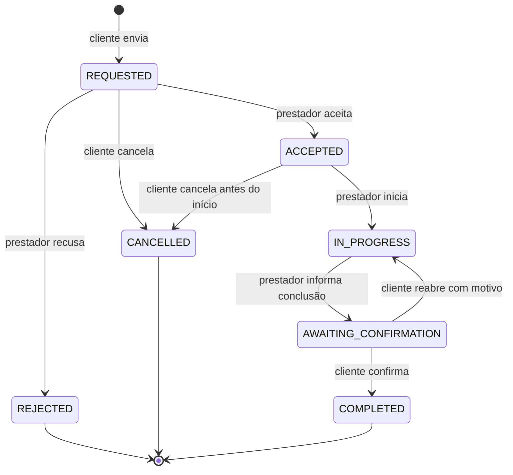

# Fase 2.4 — Solicitações e contratação direta

**Código preparado; implantação do banco pendente de revisão do responsável.** Branch `feature/fase-2-4-solicitacoes`, base `9b1c72cfa3cbeb1da13e8a4b319fae89b558d0f1`. Não houve execução de migration, GRANT, seed ou conexão com SQL Server nesta entrega. A fase só pode ser considerada concluída depois da aplicação revisada e dos testes físicos no iPhone.

## Escopo e arquitetura

Cliente encontra o prestador no catálogo real, escolhe serviço, descreve a necessidade, informa somente cidade/UF/bairro, revisa e confirma. Prestador aceita/recusa, inicia e informa conclusão; somente o cliente confirma a conclusão ou reabre com motivo. Não há pagamento, negociação financeira, chat, avaliações funcionais ou atualização em tempo real. Atualização ocorre ao focar a tela e pelo botão Atualizar.

- NestJS 11: `RequestsModule` usa `AccessGuard`, `CurrentUser`, erro padronizado e Prisma existentes. Nenhum endpoint de produção usa repositórios em memória; estes ficam exclusivamente em `apps/api/test/support/`.
- Prisma/Client/adapter MSSQL **6.19.3** preservados. `schema.prisma`: `sqlserver`; `migration_lock.toml`: `mssql` (compatibilidade deliberada da ferramenta existente).
- Expo SDK **58.0.23**, React **19.3.0**, React Native **0.88.1**, Router **58.0.30**, SecureStore **58.0.2** preservados. Adição: **expo-crypto 58.0.7**, módulo nativo incluído no Expo Go/SDK 58, para UUID criptográfico de idempotência; sem `Math.random` ou implementação criptográfica própria.
- `SessionManager` e o armazenamento de credenciais existentes continuam únicos. O adaptador RequestsApi associa-se à conta que o criou, rejeitando envios atrasados após troca de conta.
- Os endereços `/client/requests` e `/provider/requests` continuam válidos. Cada seção ganhou uma Stack ancorada em `index` com detalhe `[id]`. A Stack profissional, três cards, Ajuda, footer e proteção de formulário foram preservados. O formulário `/service-request/new` fica fora da barra e usa o mesmo guard de saída dos formulários anteriores.

## Modelo e integridade

Duas tabelas novas; nenhuma tabela/campo anterior é apagado, renomeado ou recriado.

| Estrutura             | Campos e invariantes                                                                                                                                                                                                                                                                     |
| --------------------- | ---------------------------------------------------------------------------------------------------------------------------------------------------------------------------------------------------------------------------------------------------------------------------------------- |
| `ServiceRequest`      | UUID `id`, `clientUserId`, **`providerUserId` imutável**, `providerId`, `providerServiceId`; snapshots `clientNameSnapshot`, `providerNameSnapshot`, `serviceTitleSnapshot`; `status`; descrição 1000; cidade/bairro 100, UF CHAR(2); datas DateTime2 UTC; versão inicial 1; chave UUID. |
| `ServiceRequestEvent` | UUID `id`, `requestId`, `actorUserId`, estado anterior/novo, `action`, `occurredAt`, motivo até 500, `version`, chave UUID e SHA-256 do payload normalizado. Um evento por versão, inclusive criação.                                                                                    |

Os IDs de conta, payloadHash e chaves de idempotência não são retornados nos DTOs privados de consulta. O cliente da API nunca escolhe autor ou participantes. Nomes e serviço são snapshots e não mudam quando o catálogo for editado. Localização/descrição ficam fixas após criação; não há rua, número, complemento, documento, telefone ou e-mail no contrato.

FKs para contas, perfil e serviço, todas `NoAction`. Índices de listas por participante/status/data/id e de histórico por solicitação/versão. Constraints garantem estados válidos, participantes diferentes, versão positiva, datas finais coerentes e transições legais dos eventos. Autorização e coerência entre evento/registro são garantidas pelo domínio e pela transação; CHECK não substitui autorização.

A role runtime pode inserir/consultar solicitações, atualizar **apenas** status, versão e datas de evolução. Participantes, snapshots, serviço, descrição e localização não recebem permissão de UPDATE. Eventos recebem apenas SELECT/INSERT: histórico append-only para a identidade runtime. Um administrador continua tecnicamente capaz de alterar registros; acesso administrativo requer controle operacional separado.

### Concorrência, relógio e idempotência

Cada escrita ocorre em uma transação **Serializable**, timeout 15 s/maxWait 5 s. O adaptador consulta `SYSUTCDATETIME()` no SQL Server; registro e evento recebem o mesmo instante UTC. O update compara simultaneamente ID, status e versão; se perder a corrida, retorna 409. Inserção do evento e mudança de estado são atômicas: falha do histórico desfaz a mudança.

Unicidades `(clientUserId,idempotencyKey)`, `(actorUserId,idempotencyKey)` e `(requestId,version)` protegem retries. A chave é global por autor para operações de solicitação; reutilizá-la com outra intenção retorna 409. Repetição idêntica retorna a **representação atual** da mesma solicitação, sem criar evento novamente; não promete repetir o JSON histórico antigo. Conflitos Prisma de serialização/unicidade têm até duas novas tentativas transacionais; esgotamento retorna erro seguro.

Listas: página 1..1000, tamanho 1..20 (padrão 10), ordenação `createdAt DESC, id DESC`, filtro opcional de status. Paginação offset pode deslocar resultados diante de inserções concorrentes entre páginas; atualizar a primeira página recupera a visão atual. Detalhes incluem os primeiros 20 eventos e `eventTotal` (igual à versão, um evento por versão). Histórico adicional usa cursor `afterVersion`, até 20, ordem crescente e `nextVersion` ou null.

## Estados e autorização



| Operação                   | Autorização/estado                                                                                                                                                      |
| -------------------------- | ----------------------------------------------------------------------------------------------------------------------------------------------------------------------- |
| Criar                      | Conta autenticada ativa + perfil cliente ativo; destinatário diferente; conta/perfil prestador, serviço, categoria e área ativos.                                       |
| Consultar/listar/histórico | Somente participantes; listas limitadas ao ID autenticado. Histórico existente permanece consultável por conta ativa mesmo sem perfil ativo; ações ficam indisponíveis. |
| Aceitar/recusar            | Prestador original com perfil ativo, apenas REQUESTED.                                                                                                                  |
| Iniciar                    | Prestador original ativo, apenas ACCEPTED.                                                                                                                              |
| Informar conclusão         | Prestador original ativo, apenas IN_PROGRESS.                                                                                                                           |
| Confirmar                  | Cliente original ativo, apenas AWAITING_CONFIRMATION.                                                                                                                   |
| Reabrir                    | Cliente original ativo, apenas AWAITING_CONFIRMATION; motivo obrigatório com 10..500 caracteres.                                                                        |
| Cancelar                   | Cliente original ativo, apenas REQUESTED/ACCEPTED.                                                                                                                      |

COMPLETED, CANCELLED e REJECTED são finais. Não existe cancelamento após início, reversão de conclusão, resolução de disputa ou suporte operacional nesta fase. Ajuda explica essa limitação sem apresentar ação fictícia. Reabrir limpa `completionProposedAt`, preserva início/aceite e registra motivo; nova proposta ganha novo instante. Desativação posterior de anúncio/área não apaga nem transfere solicitações já existentes. O prestador continua podendo atender os pedidos existentes enquanto conta/perfil estiverem ativos.

Área compatível: uma mesma área ativa deve combinar cidade e UF; bairro vazio na área cobre a cidade toda. Comparação de cidade/bairro é insensível a caixa/acentos com valores SQL parametrizados. Bairro vazio no pedido só é aceito para cobertura da cidade toda. Não usar endereço completo para contornar uma área incompatível.

## Endpoints e contratos

Todos exigem Bearer JWT e retornam `Cache-Control: no-store`. Swagger `/docs`, OpenAPI `/docs-json`; `/api/health` permanece independente de banco.

| Método e caminho (prefixo `/api`)           | Resultado                                                                           |
| ------------------------------------------- | ----------------------------------------------------------------------------------- |
| POST `/requests`                            | 201, mesmo ID em repetição idêntica.                                                |
| GET `/requests/sent`                        | `RequestPage`, somente enviadas pela conta.                                         |
| GET `/requests/received`                    | `RequestPage`, somente recebidas pela conta prestadora original.                    |
| GET `/requests/by-key/:key`                 | Recupera criação própria por chave; nunca cria. 404 se não encontrada para a conta. |
| GET `/requests/:id`                         | `ServiceRequestDetail`, incluindo ações autorizadas e primeiros 20 eventos.         |
| GET `/requests/:id/history?afterVersion=20` | `RequestHistoryPage {items,total,nextVersion}`, autorizado e paginado.              |
| POST `/requests/:id/accept`                 | REQUESTED → ACCEPTED.                                                               |
| POST `/requests/:id/reject`                 | REQUESTED → REJECTED.                                                               |
| POST `/requests/:id/start`                  | ACCEPTED → IN_PROGRESS.                                                             |
| POST `/requests/:id/propose-completion`     | IN_PROGRESS → AWAITING_CONFIRMATION.                                                |
| POST `/requests/:id/confirm-completion`     | AWAITING_CONFIRMATION → COMPLETED.                                                  |
| POST `/requests/:id/reopen`                 | AWAITING_CONFIRMATION → IN_PROGRESS, motivo obrigatório.                            |
| POST `/requests/:id/cancel`                 | REQUESTED/ACCEPTED → CANCELLED.                                                     |

Criação (UUIDs ilustram formato; use IDs reais do catálogo e chave nova por intenção):

```json
{
  "providerId": "UUID do perfil profissional",
  "providerServiceId": "UUID do serviço ativo",
  "description": "Preciso instalar duas tomadas na sala.",
  "city": "Araranguá",
  "state": "SC",
  "neighborhood": "Centro",
  "idempotencyKey": "UUID criptográfico estável neste envio"
}
```

Ações: `{ "version": 1, "idempotencyKey": "UUID", "reason": "opcional, exceto reopen" }`. Campos extras são rejeitados; descrições 10..1000, cidade 2..100, UF válida do Brasil, bairro 0..100. Filtros desconhecidos/arrays/tamanhos excessivos são rejeitados. Contratos em `packages/shared/src/index.ts` incluem os sete estados, transições, DTOs, histórico e ações por participante.

Erros seguem o formato existente `{statusCode,code,fields,message,timestamp}`: 400 dados/alvo inválido, 401 sessão, 403 perfil/ação, 404 não acessível ou inexistente, 409 concorrência/estado/idempotência, 429 excesso, 503 persistência indisponível. Não retornar SQL, driver, token ou conteúdo rejeitado. Rate limit por conta e IP, separado em leitura/escrita: 180/360 leituras e 30/60 escritas por minuto; Retry-After 60. Armazenamento do limitador é local ao processo e limitado a 10 mil entradas; múltiplas réplicas precisarão de limitador compartilhado antes de escalar.

Proteção de privacidade: UI e API orientam a usar somente descrição do trabalho e localização aproximada. Rejeitam padrões evidentes de contatos/documentos/URL/endereço com número. Isso é uma barreira conservadora, não um detector universal de dados pessoais: pode haver falso positivo e texto disfarçado pode escapar. Não registrar payloads em logs; revisar política de retenção, consentimento e moderação antes de expansão. Não adicionar busca pública de solicitações.

## Sessão, envio incerto e experiência mobile

- Login/cadastro recebem apenas intenção interna validada (UUIDs + seção conhecida), sem URL arbitrária de retorno. Retomar não envia automaticamente: o cliente escolhe, revisa e confirma.
- Formulário usa confirmação de saída e trava enquanto envia; um ref bloqueia duplo toque. CTA real só existe no catálogo real. Demonstração mantém placeholders sem gravar pedidos.
- Antes do primeiro POST, o payload revisado e a chave UUID são registrados no **SecureStore**, namespace `omini.requests.pending.v1.<userId>`, distinto das credenciais. Blocos de 400 codepoints, até 16, evitam exceder tamanho de Keychain; manifesto é gravado por último e dispositivo somente enquanto desbloqueado. Não usar AsyncStorage/localStorage para este registro.
- Falha de armazenamento impede o POST. Reenvio usa a mesma chave e payload; primeiro consulta `by-key`. Falha de rede/503/401 mantém o registro, inclusive após reiniciar/reautenticar. A lista mostra **Conferir envio pendente** para localizar ou reenviar com segurança. O backend verifica novamente a elegibilidade se ainda não houve criação.
- Não substituir um envio pendente por outro. Após resposta confirmada, limpar o registro; falha de limpeza é recuperável pela mesma chave. Rejeição definitiva de validação/autorização permite corrigir ou descartar explicitamente; incerteza não habilita descarte silencioso.
- Registro fica isolado por conta e não é exibido a outra conta após logout. É retido para recuperação pelo proprietário; contém dados minimizados, não tokens. Política de expiração/purga de registros locais órfãos é pendência antes de distribuição ampla. Rascunho ainda não enviado é apenas em memória e pode ser perdido se o processo/sessão encerrar; a intenção de prestador/serviço é retomada.
- Detalhes mostram somente ações permitidas pelo servidor. Confirmações têm linguagem acessível, motivo de reabertura, loading, erro, conflito com recarga e estado de sessão expirada. Retry de ação preserva chave/payload durante a tentativa; após reinício, recarregar estado antes de decidir nova ação.
- Listas, filtros e detalhes usam componentes responsivos existentes, texto com ícone, botões ≥44 pontos, sem truncamento deliberado. Safe area, teclado e retorno ao painel seguem os componentes da base. VoiceOver e Keychain nativos precisam do teste físico abaixo.

## Arquivos importantes

- `apps/api/prisma/schema.prisma`; `apps/api/prisma/migrations/20261112000000_service_requests/migration.sql`.
- `docs/sql/requests-runtime-permissions.sql`; `apps/api/scripts/check-migrations.ts`; teste de persistência atualizado apenas para 11 modelos.
- `apps/api/src/requests/{requests.module,requests.controller,requests.service,requests.repository,prisma-requests.repository,requests-rate.guard,validation}.ts`.
- `apps/api/src/app.module.ts`, `configure-app.ts`; testes `requests.test.ts`, `requests-prisma.test.ts`, `requests-sql.test.ts`, `test/support/memory-requests.repository.ts`.
- `packages/shared/src/index.ts`: domínio e contratos.
- `apps/mobile/src/requests/`: API, intenção de autenticação, diário seguro, feedback, formulário, listas, detalhes e componentes.
- `apps/mobile/app/{client,provider}/requests/{_layout,index,[id]}.tsx`; `app/service-request/{new,resume}.tsx`; root provider de feedback.
- `AuthForm.tsx` (somente retorno após login/cadastro), `CatalogScreens.tsx`, `marketplace/api.ts`, `components.tsx`, `provider/{FlowUI,ProviderNavigation}.tsx`.
- `apps/mobile/test/{requests-navigation,requests-storage}.test.*`, suporte de rotas/mocks e um assert atualizado do CTA no teste do catálogo real.
- `apps/mobile/package.json`, `package-lock.json`, `scripts/check-routes.mjs`, CI, README e proposta de avaliações.

## Impacto, pré-requisitos e implantação

Migration **`20261112000000_service_requests`**, caminho exato **`apps/api/prisma/migrations/20261112000000_service_requests/migration.sql`**. Permissões **`docs/sql/requests-runtime-permissions.sql`**. SQL completo nas seções finais deste documento, idêntico aos arquivos versionados.

1. Responsável/DBA revisa SQL, diff, backups, inventário das tabelas/contagens, migrations anteriores e permissões efetivas da role/`omini_app`. Não usar runtime como identidade de migration. Preservar oito categorias e todos os cadastros.
2. Validar primeiro em cópia isolada do banco, com identidades separadas, inclusive grants por coluna, FKs, CHECKs, corrida real, rollback e plano das consultas. Simulações desta entrega não comprovam esses comportamentos no SQL Server.
3. Preparar backup recuperável e janela de implantação. DDL aditivo pode bloquear metadados; embora só crie tabelas/índices novos, agendar e monitorar. Rever privilégios herdados que poderiam permitir UPDATE/DELETE fora dos grants mínimos.
4. **Somente após aprovação**, aplicar por Prisma Migrate com identidade de migration já configurada em `.env.migrations` local ignorado. A ferramenta usa `MIGRATION_DATABASE_URL`, exige OminiDB e rejeita `omini_app`. Ela não usa as credenciais runtime como fallback. O deploy percorre todas as migrations pendentes: antes, conferir que apenas a nova está pendente; não aplicá-lo cegamente se o histórico divergir.
5. **Somente após aprovação**, DBA aplica o GRANT incremental no contexto OminiDB, depois da migration. Nenhum script é executado pelo startup do NestJS.
6. Verificar somente leitura no SSMS, reiniciar API atualizada e testar com `omini_app`; depois atualizar mobile. Não expor CTA novo antes do backend e das permissões. Clientes antigos continuam usando endpoints anteriores.
7. Habilitar os testes físicos com duas contas distintas. API existente depende das flags locais de autenticação/persistência; não alterar senhas/JWT durante este deploy.

### Recuperação

Migration usa transação/XACT_ABORT e rollback em erro; se a ferramenta acusar falha, parar e conferir tabelas e `_prisma_migrations` com DBA. Não marcar como aplicada ou resolvida sem comparar a execução real. Não rodar novamente SQL à força: guards recusam objetos já existentes. O arquivo não é um seed nem script idempotente de criação repetida; Prisma controla a aplicação única.

Se o deploy da aplicação falhar, voltar **apenas API/mobile** à versão anterior aprovada e manter novas tabelas/dados intactos. Desabilitar novos envios operacionalmente durante a recuperação, sem apagar histórico. Não oferecer DROP/reset como rollback automático. Se houver corrupção ou aplicação parcial fora da transação, restaurar primeiro em ambiente isolado e definir correção incremental revisada. Não compartilhar banco com uma versão antiga que tente migrá-lo novamente.

## Windows / PowerShell — atualizar sem tocar no banco

Terminais de API/Expo parados; preservar todos os `.env` locais. Se o checkout estiver sujo, revisar/salvar alterações antes; não usar reset hard/clean.

```powershell
Set-Location C:\projetos\omini
git status --short
git fetch origin
git switch feature/fase-2-4-solicitacoes
git pull --ff-only origin feature/fase-2-4-solicitacoes
npm ci
npm run prisma:generate
npm run prisma:validate -w @omini/api
npm run check:migrations -w @omini/api
npm run typecheck
npm run lint
npm test
npm run build:api
npm run check:routes
npm run check:brand
npm run check:secrets
npm run check:dependencies -w @omini/mobile
```

`npm ci` gera o client Prisma, **não aplica migrations**. Validadores acima não conectam ao banco. A aplicação das estruturas e grants permanece pendente da revisão do responsável.

**Comandos reservados à etapa posterior, após aprovação e backup** (não foram executados no Codex):

```powershell
# Inspecionar os arquivos antes de qualquer execução no banco.
Get-Content apps/api/prisma/migrations/20261112000000_service_requests/migration.sql
Get-Content docs/sql/requests-runtime-permissions.sql
# Identidade de migration separada já configurada em apps/api/.env.migrations.
# Somente após revisar o histórico e autorizar a janela:
npm run db:migrate:status -w @omini/api
npm run db:migrate:deploy -w @omini/api
# DBA revisa/aplica o GRANT no SSMS usando OminiDB. Não executar com omini_app.
```

Não executar seed, `db push`, reset ou SQL antigo nesta atualização. Depois de migration/GRANT revisados, terminal 1:

```powershell
Set-Location C:\projetos\omini
npm run dev:api
```

Terminal 2:

```powershell
Set-Location C:\projetos\omini
Invoke-RestMethod http://localhost:3000/api/health
Start-Process http://localhost:3000/docs
ipconfig
# Conferir apps/mobile/.env: EXPO_PUBLIC_API_URL=http://IP_DO_WINDOWS:3000/api
# Manter os demais valores locais. No telefone não usar localhost.
npm run dev:mobile -- --clear
```

Mesma rede privada Wi-Fi, Expo Go SDK 58 atualizado, permissão Rede Local no iOS, firewall liberado apenas na rede privada (API 3000 e Metro 8081). Antes de abrir o app, testar `http://IP_DO_WINDOWS:3000/api/health` no Safari.

## Consultas de verificação no SSMS — somente leitura

Executar como DBA/leitor autorizado em OminiDB; guardar contagens **antes e depois**, sem exportar dados pessoais ou credenciais. Antes da migration, executar apenas as consultas de estruturas já existentes.

```sql
SELECT DB_NAME() AS Banco;
SELECT [name] FROM sys.tables WHERE schema_id = SCHEMA_ID(N'dbo') ORDER BY [name];
SELECT COUNT_BIG(*) AS Usuarios FROM dbo.[User];
SELECT COUNT_BIG(*) AS Clientes FROM dbo.ClientProfile;
SELECT COUNT_BIG(*) AS Prestadores FROM dbo.ProviderProfile;
SELECT COUNT_BIG(*) AS Servicos FROM dbo.ProviderService;
SELECT COUNT_BIG(*) AS Areas FROM dbo.ProviderServiceArea;
SELECT COUNT_BIG(*) AS Categorias FROM dbo.ServiceCategory;
SELECT [slug], [name], [isActive] FROM dbo.ServiceCategory ORDER BY [slug];
SELECT [migration_name], [started_at], [finished_at], [rolled_back_at]
FROM dbo._prisma_migrations ORDER BY [started_at];

-- Somente após aplicar a nova migration aprovada:
SELECT [name], [definition], [is_disabled], [is_not_trusted]
FROM sys.check_constraints
WHERE parent_object_id IN (OBJECT_ID(N'dbo.ServiceRequest'), OBJECT_ID(N'dbo.ServiceRequestEvent'));
SELECT [name], [delete_referential_action_desc], [update_referential_action_desc]
FROM sys.foreign_keys
WHERE parent_object_id IN (OBJECT_ID(N'dbo.ServiceRequest'), OBJECT_ID(N'dbo.ServiceRequestEvent'));
SELECT r.[id], r.[status], r.[version], COUNT(e.[id]) AS Eventos,
       MAX(e.[version]) AS UltimaVersao
FROM dbo.ServiceRequest r LEFT JOIN dbo.ServiceRequestEvent e ON e.requestId = r.id
GROUP BY r.[id], r.[status], r.[version]
HAVING COUNT(e.[id]) <> r.[version] OR MAX(e.[version]) <> r.[version];
-- Deve retornar zero linhas: snapshot de participantes diferente, conclusão consistente.
SELECT [id], [status] FROM dbo.ServiceRequest
WHERE clientUserId = providerUserId
   OR ([status] = N'COMPLETED' AND completedAt IS NULL)
   OR ([status] <> N'COMPLETED' AND completedAt IS NOT NULL);
-- Verificar transições reais sem projetar descrição, motivo ou contatos.
SELECT [requestId], [version], [previousStatus], [newStatus], [action], [occurredAt]
FROM dbo.ServiceRequestEvent ORDER BY [requestId], [version];
-- Grants explícitos da role (também revisar herança e papéis do usuário):
SELECT p.[permission_name], p.[state_desc], OBJECT_NAME(p.[major_id]) AS Objeto,
       COL_NAME(p.[major_id], p.[minor_id]) AS Coluna
FROM sys.database_permissions p
WHERE p.grantee_principal_id = DATABASE_PRINCIPAL_ID(N'omini_runtime_role')
  AND p.class = 1
  AND p.major_id IN (OBJECT_ID(N'dbo.ServiceRequest'), OBJECT_ID(N'dbo.ServiceRequestEvent'));
```

Para validar permissões **efetivas**, conectar uma sessão separada com a identidade runtime (sem compartilhar senha) e consultar `HAS_PERMS_BY_NAME`: SELECT/INSERT das duas tabelas = 1; UPDATE na coluna status = 1; UPDATE em clientUserId = 0; UPDATE/DELETE de evento = 0; DELETE de solicitação = 0. Não usar uma tentativa de DELETE em dados reais como teste. Grants explícitos não demonstram ausência de privilégios herdados.

## Roteiro no iPhone físico — pendente

1. Preservar os testes da Fase 2.3. Conta A cliente; conta B prestador com perfil/serviço/categoria/área ativos em Araranguá/SC, bairro Centro (ou cobertura toda a cidade). Não usar dados demonstrativos nem contatos privados nos textos.
2. Como visitante no catálogo real, abrir B → Solicitar serviço. Login/cadastro deve retomar o formulário sem criar registro. Selecionar serviço, escrever descrição, informar Centro; voltar antes de revisar deve pedir confirmação de descarte.
3. Revisar → Enviar; duplo toque não duplica. Lista de A mostra enviada, serviço e nome corretos. Abrir detalhes/histórico. Atualizar e reabrir aplicativo: sessão restaurada e pedido continua listado.
4. Trocar para B (ou segundo aparelho): Solicitações no footer → Atualizar → abrir pedido → Aceitar → confirmar. Apenas ações do estado aparecem. Voltar leva à lista, depois painel; Minha conta deve manter retorno direto ao painel.
5. B inicia. A atualiza e não pode cancelar. B informa conclusão; A vê **O serviço foi concluído?** e escolhe **Não, ainda precisa finalizar**, informa motivo obrigatório; ambos veem reabertura no histórico.
6. B informa conclusão novamente; A confirma. Estado Concluída, `completedAt` presente e histórico ordenado; B não consegue concluir unilateralmente. Finais não oferecem novas ações.
7. Pedidos independentes: B recusa; A cancela antes do aceite; A cancela após aceite e antes do início. Verificar estados finais e ausência de efeitos no catálogo/categorias.
8. Conta A com ambos os perfis não pode solicitar seu próprio serviço. Conta C não vê pedidos de A/B e link de detalhe alheio retorna indisponível. Campo de bairro incompatível/serviço desativado deve ser rejeitado com mensagem segura.
9. Durante envio, interromper rede/resposta. Retomar pela indicação **Conferir envio pendente**, inclusive após encerrar/reabrir. Verificar um único pedido/evento de criação no SSMS. Não criar novo pedido com chave diferente para “resolver” resposta incerta.
10. Expirar/revogar sessão em teste controlado: erro deve solicitar login; reautenticar na mesma conta e retomar. Trocar de conta não deve mostrar o envio pendente da anterior. Sair/entrar mantém fluxo de logout existente.
11. Testar larguras de iPhone, fonte grande/Acessibilidade, VoiceOver, teclado/rolagem, home indicator, loading/erro/retry e Ajuda. Footer não cobre conteúdo; barra fica oculta no formulário; nenhuma palavra/ação deve ser truncada.
12. Revalidar serviços/áreas/ativação/desativação, catálogo, oito categorias, sessão, três cards profissionais, retorno nativo, proteção de formulários e avaliações vazias. Registrar modelo/iOS/Expo Go/resultados antes de declarar conclusão da fase.

## Testes executados e limites

- `npm test`: **138 aprovados**, **54 API + 84 mobile**. Os 111 testes anteriores foram preservados (assert do CTA real atualizado; contagem do schema aumentou para 11 modelos). Novos testes cobrem participantes, áreas/inativos/autocontratação, ciclo completo/reabertura/finais, IDOR, payloads, filtros/paginação, versões/idempotência/concorrência, rollback, SQL estático/grants, UI real, login/expiração, formulário, diário seguro/Unicode/corrupção/isolamento/troca de conta.
- TypeScript, ESLint, build da API, validação Prisma (11 modelos), checker de migrations, rotas (37 arquivos), marca e scanner de arquivos sensíveis: aprovados. Prisma generate realizado sem conexão.
- `expo install --check`: dependências alinhadas à matriz instalada do SDK 58; modo offline avisa que não consulta a matriz remota.
- Bundles iOS e Android gerados com Metro, sem dotenv e fora do repositório. São bundles JavaScript/assets; não equivalem a build nativo assinado ou execução no aparelho.
- A verificação de segredos exigiu primeiro registrar no índice Git a movimentação das antigas rotas `requests.tsx` para pastas; o scanner foi preservado e passou após staging. Nenhuma verificação foi removida.

Expo Doctor: **18/20 verificações aprovadas**; schema remoto do Expo falhou por DNS/rede (`EAI_AGAIN exp.host`) e React Native Directory não respondeu com metadados válidos. Não foram removidas verificações nem ocultados esses resultados; executar novamente em rede com acesso. Inspeção em Chromium com cópia temporária do mobile via React Native Web e API NestJS HTTP com repositórios em memória: ciclo completo entre duas contas, reabertura e confirmação final aprovados, sem erro de JavaScript. Foram verificadas 12 combinações de tela/largura (detalhe cliente, prestador aguardando e histórico concluído, em 320/375/390/430 px), sem overflow horizontal ou botão cortado detectado. A tela de revisão também foi inspecionada em 390 px. Na cópia mobile do harness, o SecureStore foi substituído por memória; isso não valida SecureStore/VoiceOver/safe area nativos. Nenhuma dependência web/harness foi adicionada ao produto. Repositórios de teste simulam transação/rollback e o adaptador Prisma é testado com mocks; **nenhum teste afirma execução real de constraints, locking, GRANT ou conexão com SQL Server**. Não houve teste em iPhone físico, Android físico ou Keychain nativo. Backup, migration, permissões efetivas, corrida real e roteiro físico permanecem pendentes de autorização/revisão e validação do responsável.

## Migration SQL completa

```sql
-- Phase 2.4: additive request/history structures. Review before deployment.
SET XACT_ABORT ON;
BEGIN TRY
BEGIN TRANSACTION;
IF DB_NAME() <> N'OminiDB' THROW 50000, 'Expected OminiDB.', 1;
IF OBJECT_ID(N'[dbo].[User]', N'U') IS NULL THROW 50001, 'Apply existing phases first.', 1;
IF OBJECT_ID(N'[dbo].[ClientProfile]', N'U') IS NULL THROW 50001, 'Apply existing phases first.', 1;
IF OBJECT_ID(N'[dbo].[ProviderProfile]', N'U') IS NULL THROW 50001, 'Apply existing phases first.', 1;
IF OBJECT_ID(N'[dbo].[ProviderService]', N'U') IS NULL THROW 50001, 'Apply existing phases first.', 1;
IF OBJECT_ID(N'[dbo].[ProviderServiceArea]', N'U') IS NULL THROW 50001, 'Apply existing phases first.', 1;
IF OBJECT_ID(N'[dbo].[ServiceRequest]', N'U') IS NOT NULL THROW 50002, 'Request objects exist; review migration history.', 1;
IF OBJECT_ID(N'[dbo].[ServiceRequestEvent]', N'U') IS NOT NULL THROW 50002, 'Request objects exist; review migration history.', 1;

CREATE TABLE [dbo].[ServiceRequest] (
    [id] UNIQUEIDENTIFIER NOT NULL CONSTRAINT [ServiceRequest_id_df] DEFAULT (newid()),
    [clientUserId] UNIQUEIDENTIFIER NOT NULL,
    [providerUserId] UNIQUEIDENTIFIER NOT NULL,
    [providerId] UNIQUEIDENTIFIER NOT NULL,
    [providerServiceId] UNIQUEIDENTIFIER NOT NULL,
    [clientNameSnapshot] NVARCHAR(120) NOT NULL,
    [providerNameSnapshot] NVARCHAR(120) NOT NULL,
    [serviceTitleSnapshot] NVARCHAR(120) NOT NULL,
    [status] NVARCHAR(32) NOT NULL CONSTRAINT [ServiceRequest_status_df] DEFAULT (N'REQUESTED'),
    [description] NVARCHAR(1000) NOT NULL,
    [city] NVARCHAR(100) NOT NULL,
    [state] CHAR(2) NOT NULL,
    [neighborhood] NVARCHAR(100) NOT NULL CONSTRAINT [ServiceRequest_neighborhood_df] DEFAULT (N''),
    [createdAt] DATETIME2 NOT NULL CONSTRAINT [ServiceRequest_createdAt_df] DEFAULT (sysutcdatetime()),
    [updatedAt] DATETIME2 NOT NULL CONSTRAINT [ServiceRequest_updatedAt_df] DEFAULT (sysutcdatetime()),
    [acceptedAt] DATETIME2 NULL,
    [startedAt] DATETIME2 NULL,
    [completionProposedAt] DATETIME2 NULL,
    [completedAt] DATETIME2 NULL,
    [cancelledAt] DATETIME2 NULL,
    [version] INT NOT NULL CONSTRAINT [ServiceRequest_version_df] DEFAULT (1),
    [idempotencyKey] UNIQUEIDENTIFIER NOT NULL,
    CONSTRAINT [ServiceRequest_pkey] PRIMARY KEY CLUSTERED ([id]),
    CONSTRAINT [ServiceRequest_clientUserId_idempotencyKey_key] UNIQUE NONCLUSTERED ([clientUserId], [idempotencyKey])
);

CREATE TABLE [dbo].[ServiceRequestEvent] (
    [id] UNIQUEIDENTIFIER NOT NULL CONSTRAINT [ServiceRequestEvent_id_df] DEFAULT (newid()),
    [requestId] UNIQUEIDENTIFIER NOT NULL,
    [actorUserId] UNIQUEIDENTIFIER NOT NULL,
    [previousStatus] NVARCHAR(32) NULL,
    [newStatus] NVARCHAR(32) NOT NULL,
    [action] NVARCHAR(32) NOT NULL,
    [occurredAt] DATETIME2 NOT NULL CONSTRAINT [ServiceRequestEvent_occurredAt_df] DEFAULT (sysutcdatetime()),
    [reason] NVARCHAR(500) NULL,
    [version] INT NOT NULL,
    [idempotencyKey] UNIQUEIDENTIFIER NOT NULL,
    [payloadHash] CHAR(64) NOT NULL,
    CONSTRAINT [ServiceRequestEvent_pkey] PRIMARY KEY CLUSTERED ([id]),
    CONSTRAINT [ServiceRequestEvent_actorUserId_idempotencyKey_key] UNIQUE NONCLUSTERED ([actorUserId], [idempotencyKey]),
    CONSTRAINT [ServiceRequestEvent_requestId_version_key] UNIQUE NONCLUSTERED ([requestId], [version])
);

CREATE NONCLUSTERED INDEX [ServiceRequest_clientUserId_status_createdAt_id_idx] ON [dbo].[ServiceRequest] ([clientUserId], [status], [createdAt], [id]);

CREATE NONCLUSTERED INDEX [ServiceRequest_providerUserId_status_createdAt_id_idx] ON [dbo].[ServiceRequest] ([providerUserId], [status], [createdAt], [id]);

ALTER TABLE [dbo].[ServiceRequest] ADD CONSTRAINT [ServiceRequest_clientUserId_fkey] FOREIGN KEY ([clientUserId]) REFERENCES [dbo].[User] ([id]) ON DELETE NO ACTION ON UPDATE NO ACTION;

ALTER TABLE [dbo].[ServiceRequest] ADD CONSTRAINT [ServiceRequest_providerUserId_fkey] FOREIGN KEY ([providerUserId]) REFERENCES [dbo].[User] ([id]) ON DELETE NO ACTION ON UPDATE NO ACTION;

ALTER TABLE [dbo].[ServiceRequest] ADD CONSTRAINT [ServiceRequest_providerId_fkey] FOREIGN KEY ([providerId]) REFERENCES [dbo].[ProviderProfile] ([id]) ON DELETE NO ACTION ON UPDATE NO ACTION;

ALTER TABLE [dbo].[ServiceRequest] ADD CONSTRAINT [ServiceRequest_providerServiceId_fkey] FOREIGN KEY ([providerServiceId]) REFERENCES [dbo].[ProviderService] ([id]) ON DELETE NO ACTION ON UPDATE NO ACTION;

ALTER TABLE [dbo].[ServiceRequestEvent] ADD CONSTRAINT [ServiceRequestEvent_requestId_fkey] FOREIGN KEY ([requestId]) REFERENCES [dbo].[ServiceRequest] ([id]) ON DELETE NO ACTION ON UPDATE NO ACTION;

ALTER TABLE [dbo].[ServiceRequestEvent] ADD CONSTRAINT [ServiceRequestEvent_actorUserId_fkey] FOREIGN KEY ([actorUserId]) REFERENCES [dbo].[User] ([id]) ON DELETE NO ACTION ON UPDATE NO ACTION;

ALTER TABLE [dbo].[ServiceRequest] ADD CONSTRAINT [ServiceRequest_status_check] CHECK ([status] IN (N'REQUESTED',N'ACCEPTED',N'REJECTED',N'IN_PROGRESS',N'AWAITING_CONFIRMATION',N'COMPLETED',N'CANCELLED'));
ALTER TABLE [dbo].[ServiceRequest] ADD CONSTRAINT [ServiceRequest_participants_check] CHECK ([clientUserId] <> [providerUserId]);
ALTER TABLE [dbo].[ServiceRequest] ADD CONSTRAINT [ServiceRequest_version_check] CHECK ([version] >= 1);
ALTER TABLE [dbo].[ServiceRequest] ADD CONSTRAINT [ServiceRequest_completion_check] CHECK (([status] = N'COMPLETED' AND [completedAt] IS NOT NULL) OR ([status] <> N'COMPLETED' AND [completedAt] IS NULL));
ALTER TABLE [dbo].[ServiceRequest] ADD CONSTRAINT [ServiceRequest_cancellation_check] CHECK (([status] = N'CANCELLED' AND [cancelledAt] IS NOT NULL) OR ([status] <> N'CANCELLED' AND [cancelledAt] IS NULL));
ALTER TABLE [dbo].[ServiceRequest] ADD CONSTRAINT [ServiceRequest_progress_check] CHECK ([status] NOT IN (N'ACCEPTED',N'IN_PROGRESS',N'AWAITING_CONFIRMATION',N'COMPLETED') OR [acceptedAt] IS NOT NULL);
ALTER TABLE [dbo].[ServiceRequest] ADD CONSTRAINT [ServiceRequest_start_check] CHECK ([status] NOT IN (N'IN_PROGRESS',N'AWAITING_CONFIRMATION',N'COMPLETED') OR [startedAt] IS NOT NULL);
ALTER TABLE [dbo].[ServiceRequest] ADD CONSTRAINT [ServiceRequest_proposal_check] CHECK ([status] NOT IN (N'AWAITING_CONFIRMATION',N'COMPLETED') OR [completionProposedAt] IS NOT NULL);
ALTER TABLE [dbo].[ServiceRequestEvent] ADD CONSTRAINT [ServiceRequestEvent_transition_check] CHECK (
 ([previousStatus] IS NULL AND [newStatus]=N'REQUESTED' AND [action]=N'create' AND [version]=1) OR
 ([previousStatus] IS NOT NULL AND (
 ([previousStatus]=N'REQUESTED' AND [newStatus]=N'ACCEPTED' AND [action]=N'accept' AND [version]>1) OR
 ([previousStatus]=N'REQUESTED' AND [newStatus]=N'REJECTED' AND [action]=N'reject' AND [version]>1) OR
 ([previousStatus] IN (N'REQUESTED',N'ACCEPTED') AND [newStatus]=N'CANCELLED' AND [action]=N'cancel' AND [version]>1) OR
 ([previousStatus]=N'ACCEPTED' AND [newStatus]=N'IN_PROGRESS' AND [action]=N'start' AND [version]>1) OR
 ([previousStatus]=N'IN_PROGRESS' AND [newStatus]=N'AWAITING_CONFIRMATION' AND [action]=N'propose-completion' AND [version]>1) OR
 ([previousStatus]=N'AWAITING_CONFIRMATION' AND [newStatus]=N'COMPLETED' AND [action]=N'confirm-completion' AND [version]>1) OR
 ([previousStatus]=N'AWAITING_CONFIRMATION' AND [newStatus]=N'IN_PROGRESS' AND [action]=N'reopen' AND [version]>1 AND [reason] IS NOT NULL AND LEN(LTRIM(RTRIM([reason])))>=10)
 ))
);
ALTER TABLE [dbo].[ServiceRequest] ADD CONSTRAINT [ServiceRequest_time_check] CHECK ([updatedAt] >= [createdAt] AND ([acceptedAt] IS NULL OR [acceptedAt] >= [createdAt]) AND ([startedAt] IS NULL OR [startedAt] >= [acceptedAt]) AND ([completedAt] IS NULL OR [completedAt] >= [completionProposedAt]));
COMMIT TRANSACTION;
END TRY
BEGIN CATCH
    IF @@TRANCOUNT > 0 ROLLBACK TRANSACTION;
    THROW;
END CATCH;
```

## Permissões SQL completas

```sql
-- DBA review only, AFTER the incremental service_requests migration. Never startup SQL.
IF DB_NAME() <> N'OminiDB' THROW 50000, 'Select OminiDB.', 1;
IF DATABASE_PRINCIPAL_ID(N'omini_runtime_role') IS NULL THROW 50001, 'Runtime role is missing.', 1;
IF OBJECT_ID(N'[dbo].[ServiceRequest]', N'U') IS NULL THROW 50002, 'Review/apply the request migration first.', 1;
IF OBJECT_ID(N'[dbo].[ServiceRequestEvent]', N'U') IS NULL THROW 50002, 'Review/apply the request migration first.', 1;
GRANT SELECT, INSERT ON OBJECT::[dbo].[ServiceRequest] TO [omini_runtime_role];
-- Participants, service, snapshots, description, location and creation identity are immutable to runtime UPDATE.
GRANT UPDATE ON OBJECT::[dbo].[ServiceRequest] ([status], [updatedAt], [acceptedAt], [startedAt], [completionProposedAt], [completedAt], [cancelledAt], [version]) TO [omini_runtime_role];
-- Append-only audit, including idempotency receipts: no UPDATE or DELETE.
GRANT SELECT, INSERT ON OBJECT::[dbo].[ServiceRequestEvent] TO [omini_runtime_role];
```
